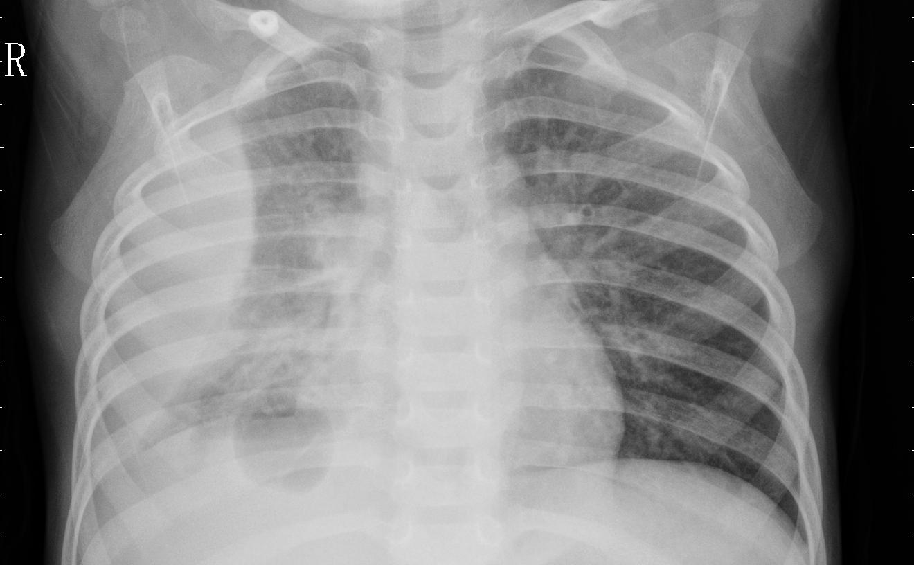

# Pneumonia Detection from Chest X-Ray Images

A research-oriented deep learning project for detecting pneumonia from chest X-ray images. Built to support extensibility, experimentation, and collaboration.

This project emphasizes model evaluation, uncertainty estimation, explainability, probability calibration, and decision-threshold optimization for medical imaging research.



## Overview

- Classifies chest X-ray images as `NORMAL` or `PNEUMONIA`
- Uses ResNet50 transfer learning with custom classification layers
- Evaluates performance using ROC-AUC, precision, recall, F1 score, and confusion matrices
- Generates Grad-CAM heatmaps for model explainability
- Estimates predictive uncertainty using Monte Carlo Dropout
- Supports decision-threshold optimization beyond the default 0.5 cutoff
- Includes probability calibration and dataset-shift analysis
- Provides modular workflows for training, evaluation, experimentation, and visualization

## Datasets

This project is configured to use two chest X-ray datasets.

### Dataset A: Chest X-Ray

- **Internal name:** `Archive/ChestXRay`
- **Expected location:** `data/archive/chest_xray/`
- **Purpose:** Primary chest X-ray dataset.

### Dataset B: Extra Dataset

- **Internal name:** `ExtraDataset`
- **Expected location:** `data/extra_dataset/`
- **Purpose:** Additional dataset for combined training and dataset-shift experiments.

The original source URLs, dataset versions, and licenses have not yet been verified. These details should be documented once confirmed against the exact datasets used.

### Class Labels

The data pipeline expects two class labels:

- `NORMAL`
- `PNEUMONIA`

### Local Directory Structure

Keep the datasets on your local computer. They are not included in this GitHub repository.

The expected directory structure is:

```text
data/
├── archive/
│   └── chest_xray/
│       ├── train/
│       │   ├── NORMAL/
│       │   └── PNEUMONIA/
│       ├── val/
│       │   ├── NORMAL/
│       │   └── PNEUMONIA/
│       └── test/
│           ├── NORMAL/
│           └── PNEUMONIA/
└── extra_dataset/
    ├── train/
    │   ├── NORMAL/
    │   └── PNEUMONIA/
    ├── val/
    │   ├── NORMAL/
    │   └── PNEUMONIA/
    └── test/
        ├── NORMAL/
        └── PNEUMONIA/
```

Update `configs/default.yaml` if your local dataset paths differ from these defaults.

### Data Processing

The current data pipeline uses TensorFlow/Keras `ImageDataGenerator` to:

- Resize images to 224 × 224 pixels
- Rescale pixel values by `1/255`
- Apply augmentation during training, including rotation, width and height shifts, shear, zoom, and horizontal flipping
- Use rescaling without training augmentations for validation data

The baseline pipeline is configured to combine the training directories and validation directories from both datasets. Dataset-shift experiments are intended to investigate model performance when training and evaluation data come from different datasets.

Before publishing results, verify the dataset sources, licenses, sample counts, and split methodology. Ensure that evaluation uses an appropriate held-out test set.

## Installation

### 1. Clone the repository

```bash
git clone https://github.com/AMatelis/DLPneumoniaDetection.git
cd DLPneumoniaDetection
```

### 2. Install dependencies

```bash
python -m pip install -r requirements.txt
```

Alternatively, install the project with its development dependencies using `pyproject.toml`:

```bash
python -m pip install -e ".[dev]"
```

### 3. Verify your environment

Use Python 3.10 or later with a compatible TensorFlow version and the required dependencies.

## Usage

The following commands are the intended entry points. Verify that the corresponding scripts exist and are configured before running them.

### Train the model

```bash
python scripts/train.py
```

### Evaluate the model

```bash
python scripts/evaluate.py
```

### Generate research figures

```bash
python scripts/generate_figures.py
```

### Run the test suite

```bash
python -m pytest -v
```

Training and evaluation require the datasets to be available locally in the expected directory structure.

## Project Structure

```text
DLPneumoniaDetection/
├── assets/
│   └── chest-xray-example.png.jpeg
├── configs/
│   └── default.yaml
├── data/                     # Local datasets; excluded from Git
├── models/                   # Local model files
├── outputs/                  # Generated results and figures
├── scripts/
│   ├── train.py
│   ├── evaluate.py
│   └── generate_figures.py
├── src/
│   └── pneumonia/
│       ├── __init__.py
│       ├── config.py
│       ├── data.py
│       ├── model.py
│       ├── training.py
│       ├── evaluation.py
│       ├── uncertainty.py
│       ├── explainability.py
│       ├── calibration.py
│       ├── thresholds.py
│       ├── dataset_shift.py
│       ├── visualization.py
│       ├── experiments.py
│       ├── api.py
│       ├── dashboard.py
│       └── cli.py
├── tests/
├── pyproject.toml
├── requirements.txt
├── README.md
└── .gitignore
```

## Research Capabilities

- **Transfer learning:** Uses a pretrained ResNet50 backbone for binary image classification.
- **Model evaluation:** Calculates classification metrics and generates evaluation plots.
- **Explainability:** Uses Grad-CAM to visualize image regions that influence predictions.
- **Uncertainty estimation:** Supports Monte Carlo Dropout for estimating predictive uncertainty.
- **Threshold optimization:** Evaluates alternative classification thresholds.
- **Probability calibration:** Provides tools to assess and calibrate predicted probabilities.
- **Dataset-shift analysis:** Supports experiments comparing performance across datasets.
- **Visualization:** Provides tools for generating research figures and summaries.

Actual performance and conclusions must be established through reproducible experiments. These capabilities do not imply that the model is clinically validated.

## Contributing

Contributions that improve reliability, reproducibility, and maintainability are welcome.

Potential areas for contribution include:

- Improving model performance and training stability
- Adding explainability or probability-calibration methods
- Evaluating generalization across datasets
- Investigating dataset shift
- Refactoring code and improving documentation
- Expanding automated test coverage
- Improving API and dashboard functionality

Please open an issue to discuss substantial changes before submitting a pull request.

## Support and Discussion

- **Bug reports:** Open a GitHub issue.
- **Feature requests:** Open an issue describing the proposed functionality.
- **Discussion:** Use GitHub Discussions if enabled for the repository.

## Intended Audience

- Students exploring machine learning and biomedical engineering
- Researchers investigating deep learning for medical imaging
- Developers studying uncertainty-aware machine learning
- Contributors interested in reproducible medical AI research

## Disclaimer

This project is intended for research and educational purposes only. It is not a validated medical device and must not be used for clinical diagnosis or treatment decisions.
